<p align="center">
  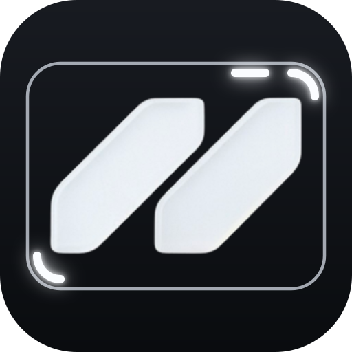
</p>

<p align="center">
  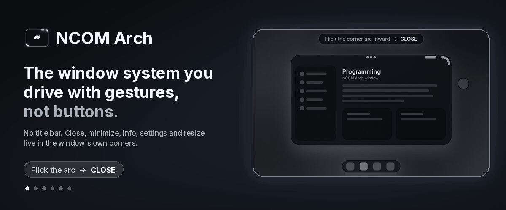
</p>

# NCOM Arch

- **What it is:** the window system for N•OS. Every window is a 24px rounded glass panel with no title-bar buttons.
- **What it does:** the window's own corners do the work. Flick the corner arc to close. Swipe the pill to minimize or maximize, and tap it for info and properties. Tap ••• for the app menu and settings, or hold it to move and snap. Drag the hidden corner to resize.
- **Why it's better:** no title-bar clutter and no tiny buttons to aim for. Each control is one gesture you learn once, and it sits in the same spot on every window, light or dark.

| Control | Gesture | Result |
|---|---|---|
| Corner arc | flick inward | **Close** (the window keeps its size, then flicks away) |
| Pill | swipe down | **Minimize** to the dock |
| Pill | swipe up | **Maximize** |
| Pill | tap | **Info / properties**: hero banner, file name, size, path, type, dates, quick settings |
| ••• | tap | **App menu / settings** |
| ••• → Settings… | tap | **Settings sheet** |
| ••• | press and hold, drag | **Move** |
| ••• | hold and drag to an edge | **Snap**: top edge = full screen, side = half |
| Hidden corner | drag | **Resize** (the handle shows only while resizing) |
| Corner on a window that can't resize | drag | **Bounce**: the corner stretches and springs back |

---

## Gestures

Each loop ends on its result. The caption bar names the gesture and the RESULT, and the dot with a trail is your finger.

### Flick the corner arc inward → Close
The window does **not** shrink while you drag. Only the arc moves a few pixels with your finger. Think of it as a flick inward: on release, the whole window closes away in the direction of the flick.

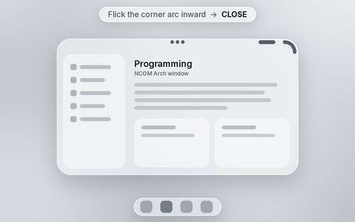

### Swipe the pill down → Minimize
The window drops into a chip beside the dock. Tap the chip to bring it back.

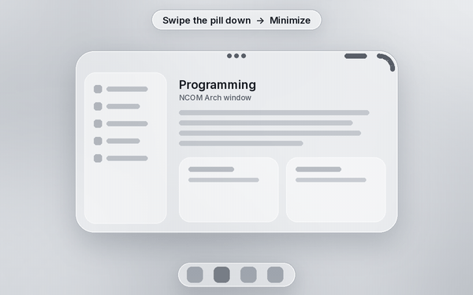

### Swipe the pill up → Maximize
The window fills the usable screen between the top bar and the dock, and keeps its 24px corners. Swipe down on the pill to restore it.

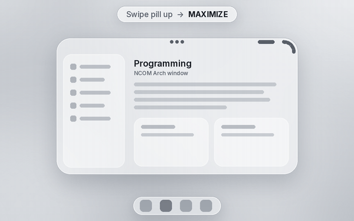

### Tap the pill → Info / properties
A glass Properties panel opens under the corner. The program's hero banner sits on top. Under it are the document's name, its file size, type, created and modified dates, and its file path (for example `C:\Users\Saidie\Documents\Plan.ncom`). At the bottom is a Settings row of quick toggles (On top, Glass, Notify) and an **Open settings…** link to the full settings sheet.

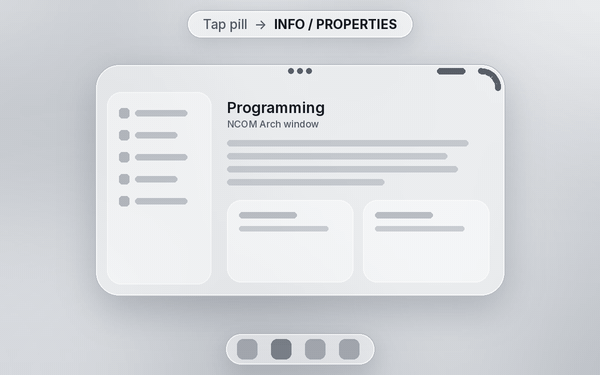

### Tap ••• → App menu / settings
The ••• opens the app's own menu. The program's File · Edit · View sit in a row at the top. Below them are the real settings, in groups:
- **App:** About, Settings…, Keyboard Shortcuts, Help & Feedback
- **Window:** Keep on Top, Snap Layout, Glass, Move to Desktop
- **This app:** Notifications, Appearance, Reset App…
- **Last:** Hide and Quit

Minimize and maximize are **not** in this menu. They live on the pill. The research behind this menu is in [docs/APP-MENU.md](docs/APP-MENU.md).

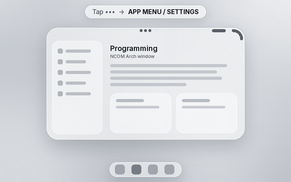

### Tap Settings… → Settings sheet
A glass settings sheet opens over the window. The sidebar has General, Appearance, Window, Notifications, Permissions, Language, Shortcuts and About. Every change applies at once.

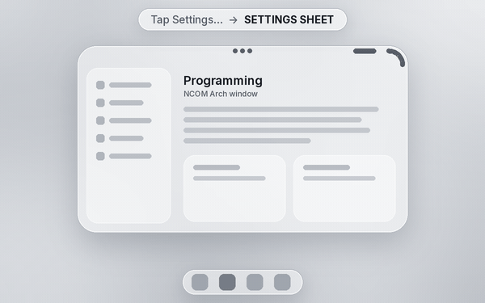

### Hold ••• → Move
Press and hold the ••• and the window lifts: its shadow deepens and it scales up slightly. Drag it, then let go to drop it.


### Hold ••• and drag to an edge → Snap
Drag to the top edge and a glass preview shows the full screen. Let go and the window fills it. Drag to the left or right edge for a half-screen snap.

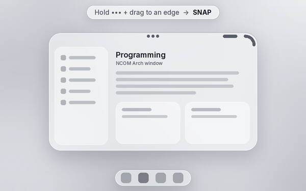

### Drag the hidden corner → Resize
The resize handle shows only while you resize. Drag the bottom corner and the window grows. The dashed line marks the old size, and the label shows the new size. When you let go, the handle hides again.

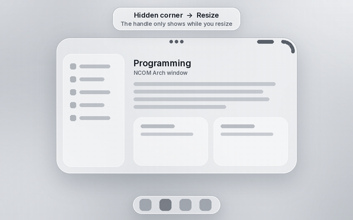

### Can't resize → Bounce
If a window can't be resized, its corner stretches like a bubble and springs back with a jiggle. That tells you this window doesn't resize.

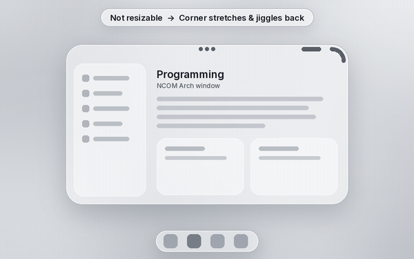

---

## Original sketches

These are Saidie's own sketches, videos and markups from October 14, 2026. They define the system.

**The first window sketch.** Drag the corner arc to close. Swipe the pill beside it down to minimize and up to maximize. Tap the ••• at the top for the menu.

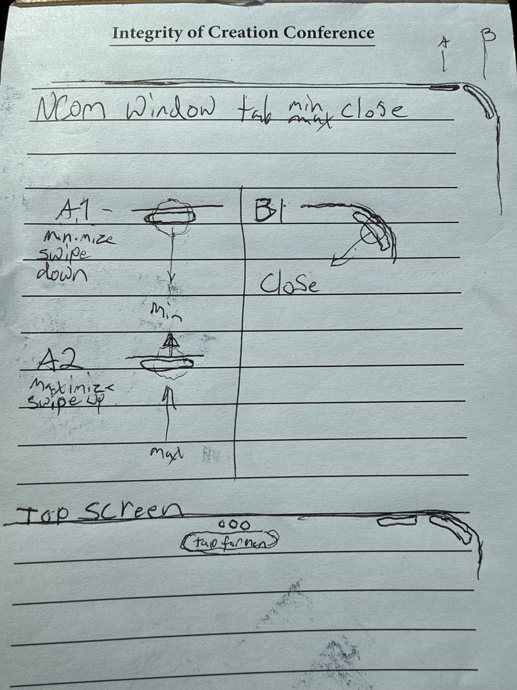

**The two sketch videos that came with it** (playable loops):

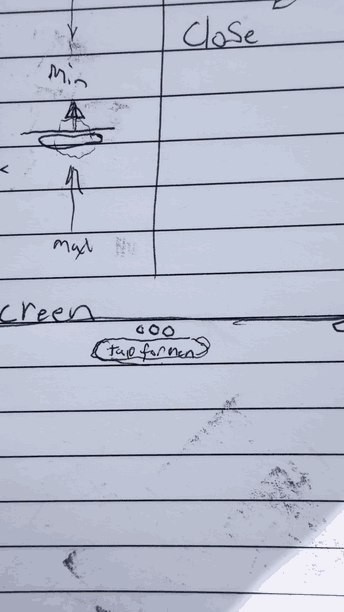 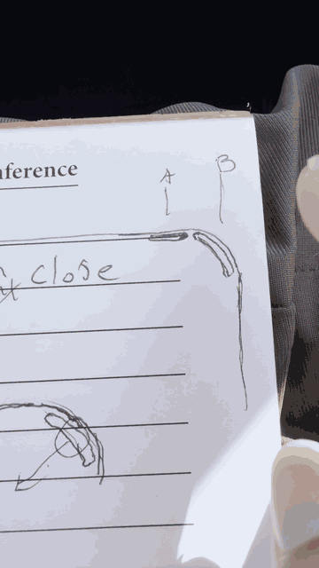

**Spec sheet.** Tapping ••• opens the program's menu along the top line. Tapping the pill opens the info popover under the corner: the program's hero banner on top, then the about info, then the options.

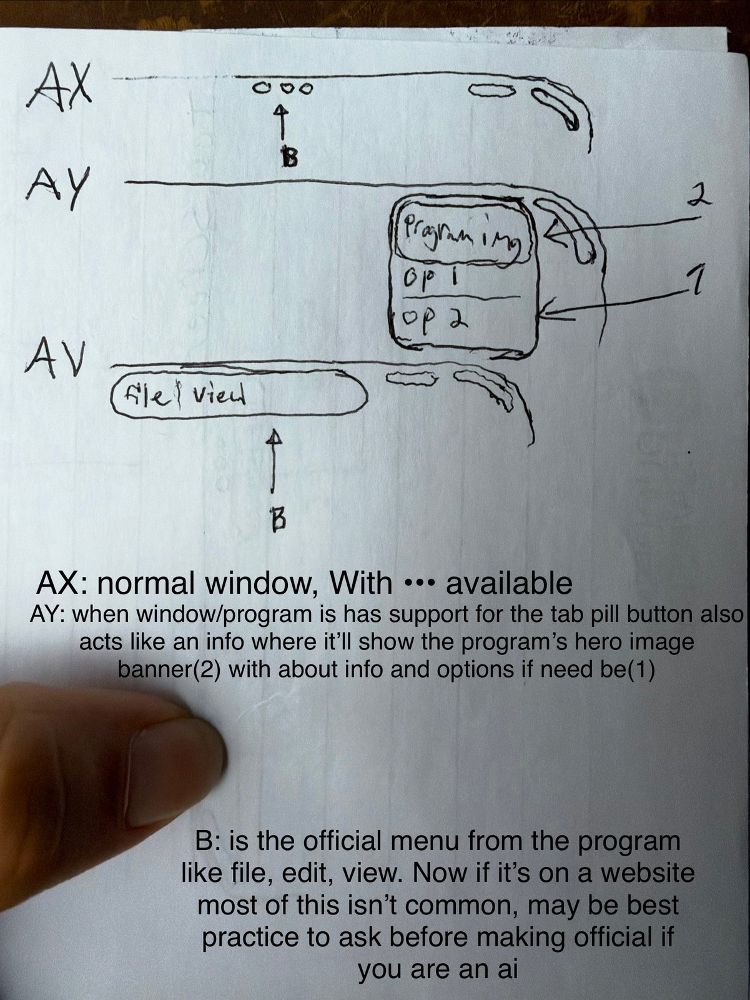

**Markups**, in the order she sent them:

| Pill = minimize / maximize / info. No Minimize or Maximize in the ••• menu. | "Oops ••• menu should be inside and centered." The toolbar was covering it. The next markup replaced this one. | "Oops ••• should be alined level go tab pill." This is the current rule, and it replaces the markup before it. | Corner arc: "not so large". | Corner reference |
|---|---|---|---|---|
| 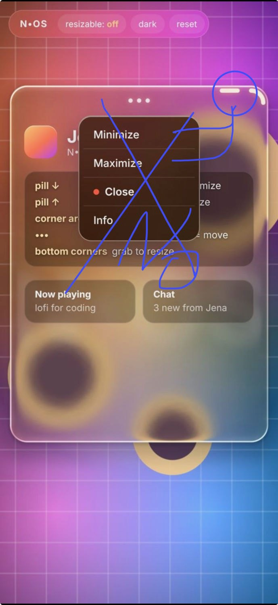 | 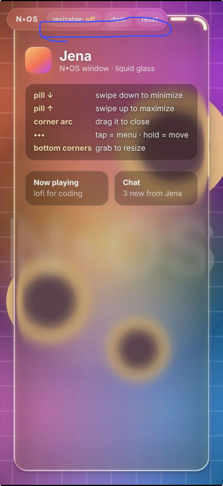 | 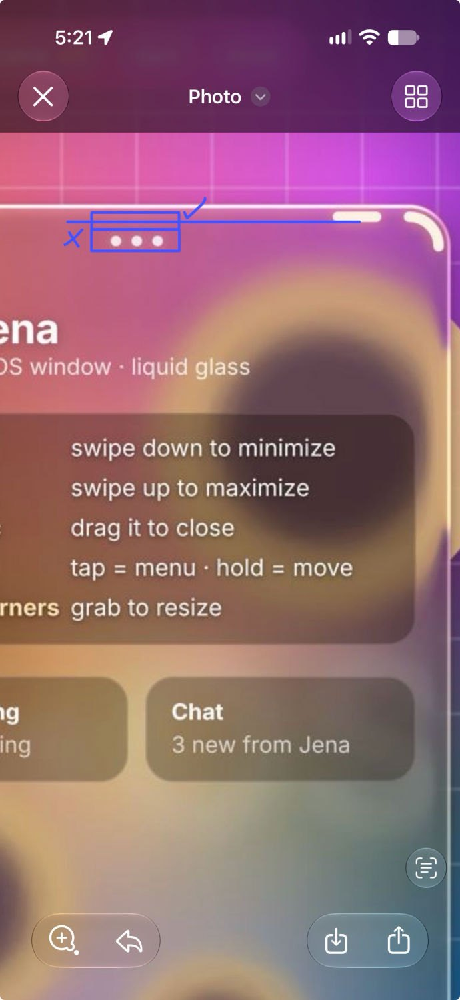 | 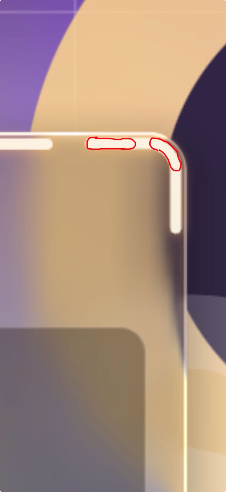 | 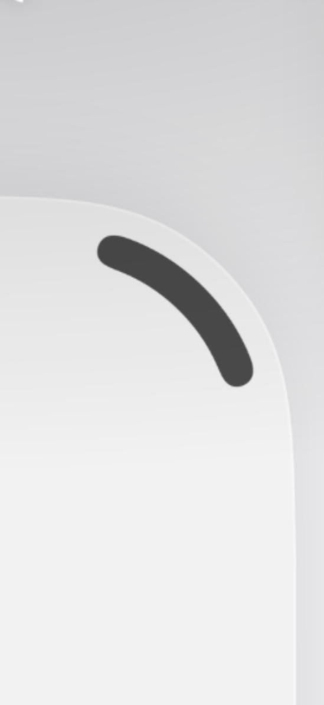 |

---

## Window anatomy (approved spec)

- **Window:** 24px corner radius, flat edges, a soft drop shadow when floating. The material is refractive glass (Apple liquid-glass style), in light and dark mode.
- **Corner arc:** a short 90° arc on the top-right corner curve only. It's concentric with the 24px radius, inset 7px, 6px thick, with round caps. It does not run down the side.
- **Pill:** 28 × 6 px, on the same line as the arc's top end, with a 13px gap. It's the only place for minimize (swipe down) and maximize (swipe up). Tapping it opens Info / Properties: the hero banner, the file's name, size, path, type and dates, then quick settings.
- **•••:** inside the window, centered on the top frame, level with the pill and the arc's top. Nothing covers it. Tap it for the app menu and settings. Hold it to move, or drag to an edge to snap.
- **Menus and popovers:** the same refractive glass as the windows.
- **Screen:** the desktop also has 24px rounded corners. Windows always fit between the top bar and the dock.

**About the GIFs:** these are animated mockups of the spec, rendered with Python, Pillow and ffmpeg. They aren't screen captures of a live N•OS build.
- The menus, the Info / Properties popover and the settings sheet are rendered as refractive glass. The background bends through the panel with a lens displacement that's strongest at the rounded edges, plus a slight chromatic split at the edge. They also get a thin bright rim along the top edge, a soft inner shadow along the bottom, and a light blur.
- The windows themselves use a lighter frosted rendering, so the gestures stay easy to read.

## The code

[](https://github.com/pfn000/NCOM-Arch/actions/workflows/ci.yml)

The window system above, as real code. One Rust core holds the rules (anatomy, gestures, window states, animation, the IPC protocol). Everything else talks to it.

```
 touchpad / touch / mouse
          │
 NcomArchKm.sys (KMDF) ──IOCTL──► NcomArch.Shell (.NET 8 service) ◄──\\.\pipe\ncom-arch──► apps, ncomctl, Python
                                         │ P/Invoke
                                         ▼
                                  ncom_arch.dll  (Rust cdylib, C ABI)
                                         │
                                  ncom-core  (Rust): anatomy · gestures · window manager · scheduler · IPC
```

| Part | Where | What it is |
|---|---|---|
| **Rust core** | `crates/ncom-core` | The approved anatomy and hit testing (24px corners, arc inset 7 / 6 thick, 28×6 pill with a 13px gap, ••• level with the pill). The gesture recognizer: arc flick-close, pill swipe and tap, ••• tap or hold-move, hidden-corner resize and bounce. The window manager: z-order, focus, keep-on-top, minimize, maximize, restore, snap full or half. An animation scheduler with the renderer's easing curves. The JSON-lines IPC protocol. |
| **Native DLL** | `crates/ncom-ffi` | `ncom_arch.dll` / `libncom_arch.so`. A C ABI (`include/ncom_arch.h`) over the core: `ncom_session_new`, `ncom_session_call` (JSON in, JSON out), `ncom_hit_test`, `ncom_string_free`. |
| **Daemon** | `crates/ncomd` | The same protocol over stdio or TCP, for any OS. |
| **C# class library** | `dotnet/src/NcomArch.Interop` | `NcomArch.Interop.dll`: P/Invoke into the core (`NcomCore`), the named-pipe server and client, and `DriverClient` for the kernel driver. |
| **C# service** | `dotnet/src/NcomArch.Shell` | The NCOM Arch shell service (.NET 8 worker, runs as a Windows Service). Hosts the core on `\\.\pipe\ncom-arch`. |
| **C# CLI** | `dotnet/src/NcomArch.Ctl` | `ncomctl`: send requests to the shell, or run the core in-process (`ncomctl --inproc demo`). |
| **Kernel driver** | `windows/driver/NcomArchKm` | `NcomArchKm.sys`, a KMDF driver with an INF. A root-enumerated input broker that passes pointer samples to the shell (see [its README](windows/driver/README.md)). |
| **Python** | `python/` | The `ncom-arch` package: the spec in pure Python, `ctypes` bindings to the core, an IPC client, the GIF and hero renderer (it was `tools/gif-render`), and the `ncom-arch` CLI. |
| **CI** | `.github/workflows/ci.yml` | Ubuntu: Rust tests and build, then Python tests against the real `.so`. windows-latest: the DLL, the .NET tests and smoke tests. The driver builds twice: on windows-latest with the WDK from NuGet, and on windows-2022 with the installed WDK. Both runs check the INF with InfVerif and test-sign the driver. Every job uploads its build. |

### Build it

```bash
# Rust core, DLL, daemon (any OS)
cargo test --workspace
cargo build --release --workspace          # target/release/ncom_arch.dll | libncom_arch.so, ncomd
echo '{"cmd":"hello"}' | target/release/ncomd

# Python
pip install -e "python[dev]"
NCOM_ARCH_LIB=target/release/libncom_arch.so pytest python/tests
ncom-arch render arc_close out.gif          # re-render a gesture GIF (needs ffmpeg)
ncom-arch hero assets/brand/hero.gif assets/brand/hero.png

# .NET 8 (after the cargo release build, which the projects pick up from target/release)
dotnet test dotnet/NcomArch.sln
dotnet run --project dotnet/src/NcomArch.Shell          # serves \\.\pipe\ncom-arch
dotnet run --project dotnet/src/NcomArch.Ctl -- demo    # talks to it

# Kernel driver (Windows, Visual Studio 2022 + WDK)
msbuild windows\driver\NcomArchKm\NcomArchKm.vcxproj /p:Configuration=Release /p:Platform=x64
```

The protocol, one JSON object per line:

```
-> {"cmd":"open","title":"Plan","app":"Notes","rect":{"x":95,"y":64,"w":410,"h":232}}
<- {"ok":true,"result":{"id":1},"events":[{"event":"opened","id":1,...},{"event":"focused","id":1}]}
-> {"cmd":"pointer","kind":"down","x":451,"y":71,"t_ms":0}
-> {"cmd":"pointer","kind":"up","x":451,"y":101,"t_ms":120}
<- {"ok":true,"events":[{"event":"minimized","id":1}]}
```

Other commands: `hello`, `configure`, `close`, `minimize`, `maximize`, `restore`, `focus`, `snap`, `move`, `resize`, `tick`, `list`, `hit_test`, `anatomy`, `properties`, `menu`, `menu_action`, `set_quick`, `settings_sections`.

### Status: what's real and what's a stub

**Working and tested in CI**
- Rust core: anatomy, hit testing, every gesture in the table above, window states, snapping, z-order and keep-on-top, the ••• menu and Properties data, and the animation scheduler. All covered by unit tests.
- `ncom_arch.dll` / `.so` with a C ABI. It's called from Rust tests, from Python (`ctypes`) and from .NET (P/Invoke). The Python tests check that the Python spec and the Rust core give the same hit test on a grid over a window.
- `ncomd` (stdio and TCP). The .NET shell service on a named pipe, and `ncomctl`.
- The Python package: tests, wheel, and the GIF and hero renderer.

**Builds, but not proven on a real machine yet**
- `NcomArchKm.sys` compiles with the WDK at `/W4 /WX`. Its INF gets stamped and passes InfVerif, its catalog gets made, and the driver is **test-signed** with a throwaway certificate. It has not been loaded on a PC yet. Its inputs come from user mode for now; reading the touchpad itself needs a HID filter driver, which isn't written.
- **Production signing needs Saidie's EV code-signing certificate and Microsoft attestation signing (Partner Center).** A test-signed driver only loads with `bcdedit /set testsigning on`.

**Not built yet**
- Drawing. There's no compositor or glass renderer drawing real windows on Windows yet. The core says where every window is and what each gesture did; something still has to draw it. The Python renderer draws the GIF mockups only.
- Hooking real Win32 windows (moving other apps' windows via `SetWindowPos`, and so on).
- QR share from the pill, Universal Clipboard (iPhone → Windows) and Apple ID sign-in.

## Repo layout

```
assets/       brand (NCOM Arch logo, hero banner, official NCOM logo + symbol), sketches, gesture GIFs
docs/         APP-MENU.md: research and the recommended ••• app menu / settings
crates/
  ncom-core/  Rust core: anatomy, gestures, window manager, scheduler, IPC (+ unit tests)
  ncom-ffi/   ncom_arch.dll / libncom_arch.so, C ABI + include/ncom_arch.h
  ncomd/      protocol daemon (stdio / TCP)
dotnet/
  src/NcomArch.Interop/   class library (DLL): P/Invoke, named pipe, driver client
  src/NcomArch.Shell/     .NET 8 shell service (Windows Service capable)
  src/NcomArch.Ctl/       ncomctl CLI
  tests/NcomArch.Tests/   xUnit tests
windows/driver/NcomArchKm/  KMDF driver: Driver.c, Public.h, NcomArchKm.inf, .vcxproj
python/       ncom-arch package (spec, native bindings, client, renderer, CLI) + tests
.github/workflows/ci.yml
```

The scenes are `arc_close`, `pill_minimize`, `pill_maximize`, `pill_info`, `dots_menu`, `dots_settings`, `dots_move`, `dots_snap`, `resize` and `bubble`. The renderer uses the Inter font (`NCOM_FONT=/path/to/Inter.ttf`) and falls back to Pillow's built-in font.

---

<sub>© NCOM Systems. Design by Saidie. All rights reserved.</sub>
