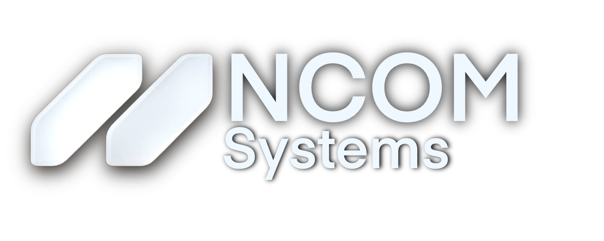
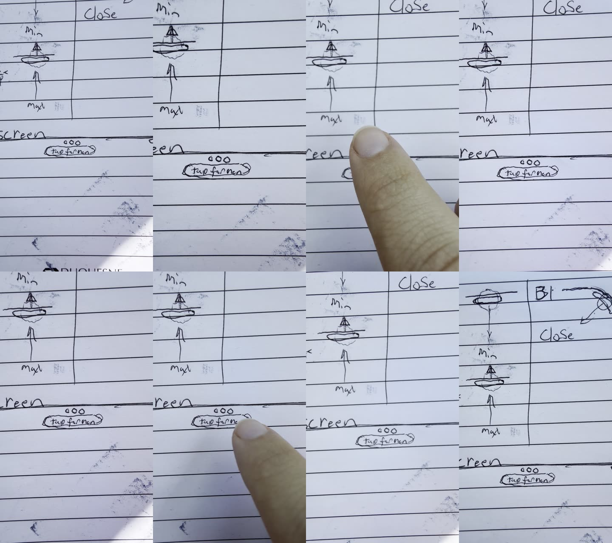
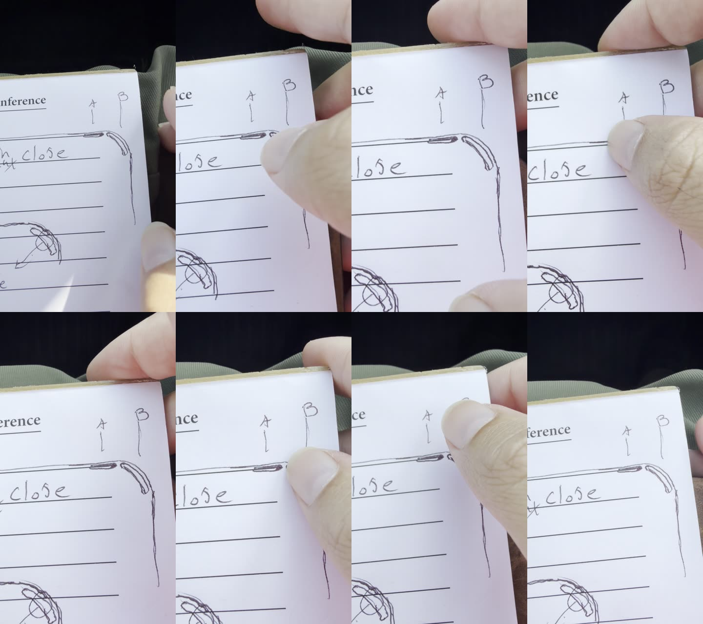

<p align="center">
  
</p>

# NCOM Arch

**NCOM Arch is the window system for N•OS.** Every window is a 24px rounded glass panel with a soft drop shadow. All of its controls sit on one line along the top edge: the **•••** in the center, and the **pill** and **corner arc** at the top right. There are no title-bar buttons. Each control has a gesture.

| Control | Gesture | What it does |
|---|---|---|
| Corner arc | drag inward | Close |
| Pill | swipe down | Minimize |
| Pill | swipe up | Maximize |
| Pill | tap | Program info popover (hero banner, about, options) |
| ••• | tap | The program's own menu (File · Edit · View) |
| ••• | press and hold | Move the window |
| Bottom corner | drag | Resize (the handle stays hidden until you resize) |
| Bottom corner, not resizable | drag | The corner stretches like a bubble and jiggles back |

---

## Original sketches

These are Saidie's own sketches and markups (October 14, 2026). They define the system.

**The first window sketch.** The corner arc is dragged to close. The pill beside it is swiped down to minimize and up to maximize. The ••• at the top is tapped for the menu.


**Frames from the two sketch videos that came with it.**




**Spec sheet.** Tapping ••• opens the program's File / Edit / View menu along the top line. Tapping the pill opens the info popover under the corner, with the program's hero banner on top, then the about info, then the options.


**Markups.**

| Pill = minimize / maximize / info. No Minimize or Maximize in the ••• menu. | ••• sits level with the pill. | Corner arc: "not so large". | Corner reference |
|---|---|---|---|
|  |  |  |  |

---

## Gestures

### Drag the corner arc → Close
Grab the arc on the top-right corner and pull it inward. The window follows your finger. Let go past the threshold and the window closes.


### Swipe the pill down → Minimize
The window drops into a chip beside the dock. Tap the chip to bring the window back.


### Swipe the pill up → Maximize
The window fills the usable screen between the top bar and the dock and keeps its 24px corners. Swipe down on the pill to restore it.


### Tap the pill → Program info
A glass popover opens under the corner. The program's hero banner is on top, then the about info, then the options. Tap outside to dismiss it.


### Tap ••• → App menu
The ••• opens into the program's own menu (File · Edit · View) along the top line. Minimize and maximize are not in this menu; they live on the pill.


### Hold ••• → Move
Press and hold the ••• and the window lifts: its shadow deepens and it scales up slightly. Drag to move it, then let go to drop it.


### Hidden corner → Resize
A resize handle shows only while you resize. Drag the bottom corner and the window grows. When you let go, the handle hides again.


### Not resizable → Bubble jiggle
If a window can't be resized, its corner stretches like a bubble and snaps back with a jiggle. That tells you this window doesn't resize.


---

## Window anatomy (approved spec)

- **Window:** 24px corner radius, flat edges, a soft drop shadow when floating. Material is real refraction glass (Apple liquid-glass style), in light and dark mode.
- **Corner arc:** a short 90° arc on the top-right corner curve only. It is concentric with the 24px radius, inset 7px, 6px thick, with round caps. It does not run down the side.
- **Pill:** 28 × 6 px, on the same line as the arc's top end, with a 13px gap. It is the only place for minimize (swipe down) and maximize (swipe up). Tapping it opens program info.
- **•••:** inside the window, centered on the top frame, and level with the pill and the arc's top. Nothing covers it. Tap opens the menu; hold moves the window.
- **Menus and popovers:** the same glass as the windows, not a CSS blur.
- **Screen:** the desktop itself has 24px rounded corners too. Windows always fit between the top bar and the dock.

## Repo layout

```
assets/
  brand/      NCOM logo + symbol (official artwork, unchanged)
  sketches/   Saidie's original sketches, markups and sketch-video frames
  gifs/       one gray UI loop per gesture (600 px wide, under 2 MB each)
tools/
  gif-render/ the script that renders the GIFs (Python + Pillow + ffmpeg)
```

To re-render a GIF: `python3 tools/gif-render/scenes.py arc_close out.gif` (scenes: `arc_close`, `pill_minimize`, `pill_maximize`, `pill_info`, `dots_menu`, `dots_move`, `resize`, `bubble`). It needs the Inter font (`NCOM_FONT=/path/to/Inter.ttf`) and ffmpeg.

---

<sub>© NCOM Systems. Design by Saidie. Private repository.</sub>
